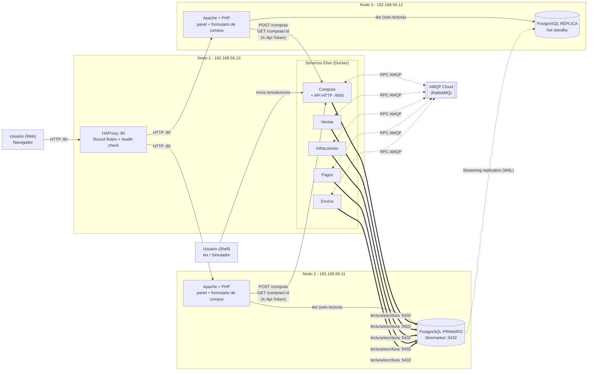

# Arquitectura Lab 4 (opción B)

La web (Apache + PHP en N2 y N3) lee de su base local y, para iniciar una compra, hace un `POST` a la API HTTP de Compras en el Nodo 1. Los servicios Elixir son los únicos que escriben en el primario. Detalle en [PLAN_LAB4.md](./PLAN_LAB4.md).

Referencias: las líneas gruesas son las escrituras de los servicios Elixir hacia el primario; las punteadas son AMQP y la replicación; las flechas de la web hacia Compras son los comandos HTTP.
